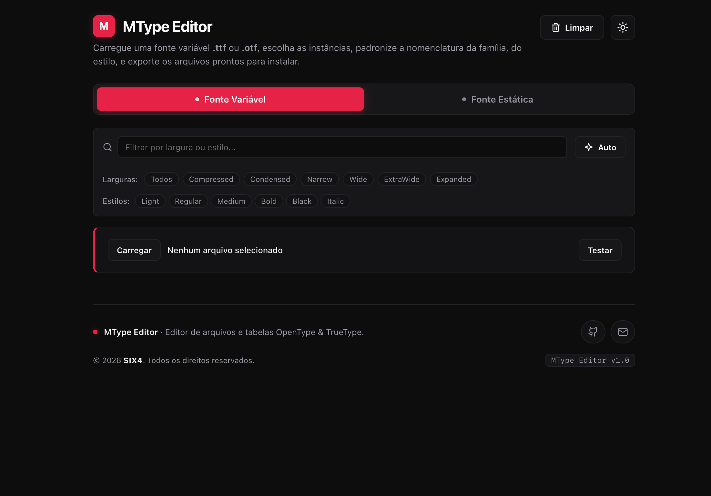
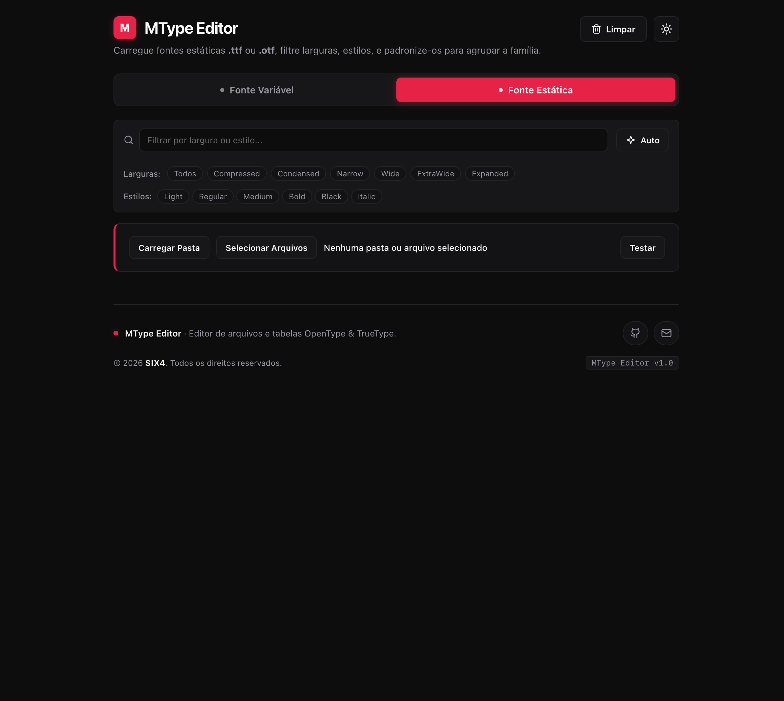

# MType Editor

O **MType Editor** é uma aplicação web para organizar, extrair e padronizar famílias tipográficas **.ttf** e **.otf**, garantindo o agrupamento correto de pesos e estilos em sistemas operacionais e softwares diversos.

Todo o processamento ocorre localmente no navegador, garantindo velocidade e total privacidade para arquivos e licenças comerciais.

## Principais Funcionalidades

A ferramenta conta com dois modos principais de operação:

### 1. Fonte Variável (Extração de Instâncias)

Converte um arquivo de fonte variável em fontes estáticas independentes, prontas para instalação:

**Inspeção de Eixos**: Identifica automaticamente os eixos disponíveis na fonte (como Peso, Largura e Inclinação).

**Agrupamento por Subfamília**: Organiza as instâncias visualmente para facilitar a separação de variações de largura.

**Exportação Seletiva**: Permite selecionar apenas os estilos desejados, ajustar os nomes e baixar o pacote **.zip** final.

---

### 2. Fontes Estáticas (Renomeação em Lote)

Padroniza coleções de fontes estáticas já separadas para que sejam reconhecidas como uma única família tipográfica:

**Processamento em Massa**: Carrega pastas inteiras ou múltiplos arquivos simultaneamente.

**Organização de Subfamílias**: Agrupa variações como Condensed, Narrow, Wide e Expanded de forma estruturada.

**Nomenclatura Limpa**: Atualiza os metadados internos de agrupamento e exporta os arquivos padronizados em um único .zip.

---

### Filtro Rápido e Padronização Automática

Para agilizar a edição de grandes famílias tipográficas, a barra de ferramentas oferece:

**Filtros Rápidos**: Busca em tempo real e atalhos para filtrar larguras e estilos.

**Botão [Auto]**: Identifica abreviaturas comuns da indústria tipográfica nos nomes originais e separa automaticamente as variações de largura (para o nome da família) e os pesos/inclinações (para o estilo).

### Privacidade

**100% Local**: Nenhum arquivo de fonte é enviado para servidores externos. Todo o trabalho de leitura, conversão e empacotamento **.zip** acontece diretamente na memória do seu navegador.

---